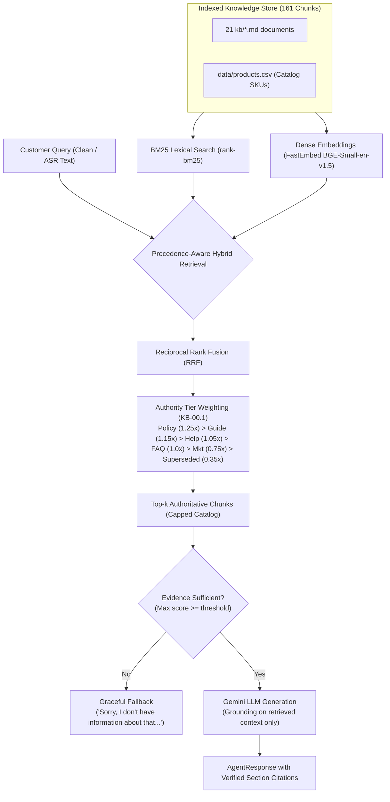
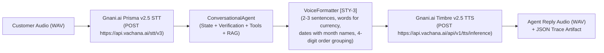

# VoiceOps 2026: ZentroMart Customer Support Agent

**GitHub Repository:** https://github.com/manasgeed/voiceops-2026  
**Author:** Manas Geed  
**Course:** From Tokens to Transformers: A Course on GenAI × LLM Mastery (Consulting & Analytics Club, IIT Guwahati × Gnani.ai)  

An enterprise-grade, multi-stage conversational AI agent built for **ZentroMart**, an Indian online store selling electronics, groceries, fashion, and home goods.

---

## 1. Project Stages & Current Status

| Stage | Milestone | Focus | Status |
| :--- | :---: | :--- | :---: |
| **Setup & Testing** | **Milestone 0** | Workspace setup, config, dataset verification, unit testing suite | **COMPLETED** (11/11 tests passing) |
| **Stage 1 Baseline** | **Milestone 1** | Prompting-only LLM baseline without RAG or tools | **COMPLETED** (52/52 evaluated on Gemini; 13.5% decision, 25.0% fact recall) |
| **Stage 2 Grounded RAG**| **Milestone 2** | Precedence-aware hybrid retrieval, document grounding, citation tracking | **COMPLETED** (52/52 evaluated on Gemini; 76.9% decision, 55.8% fact recall) |
| **Stage 3 Agent & Tools**| **Milestone 3** | Multi-turn stateful agent, ID verification gate (1 retry limit), mock tools, escalation tickets | **COMPLETED** (23 convs/96 turns evaluated on Gemini; 97.9% decision, 99.0% tools, 95.8% fact recall) |
| **Stage 4 Speech AI** | **Milestone 4** | Gnani STT (Prisma v2.5) and TTS (`timbre-v2.5` / `v3.0`), voice formatting [STY-3], batch audio CLI | **COMPLETED** (12/12 tests passing; live STT/TTS roundtrip & batch CLI verified) |
| **Stage 5 Packaging** | **Milestone 5** | Regression testing (67/67 passed), 4-page report (`report.pdf`), 2-min demo (`demo.mp4`), submission archive | **COMPLETED** |

---

## 2. Architecture & Stage 2 Document-Grounded RAG



### Policy Precedence Hierarchy (`KB-00.1`)
1. **Tier 1 — Current Policies (`pol_*.md` status=current) & Meta:** Decisive authority on returns, refunds, cancellations, warranties.
2. **Tier 2 — Agent Guides (`agent_*.md`) & Catalog (`products.csv`):** Operational rules (identity verification, escalation) and product specs.
3. **Tier 3 — Help Articles (`help_*.md`):** Troubleshooting and customer guides.
4. **Tier 4 — FAQs (`faq_*.md`):** General and Hindi FAQs.
5. **Tier 5 — Marketing Material (`mkt_*.md`):** General benefit descriptions; **never** override policy rules (e.g. Plus benefits claim vs policy).
6. **Tier 6 — Superseded Documents (`pol_returns_v3_superseded.md`):** Downranked unless historical grandfathering applies.

---

## 3. Installation & Setup

### Prerequisites
* Python 3.10+ (tested on Python 3.14)
* pip package manager

### Install Dependencies
```bash
pip install -r requirements.txt
```

### Local Environment Configuration
Copy `.env.example` to `.env` and insert your personal API credentials:
```bash
cp .env.example .env
```
Populate `.env`:
```ini
# Google Gemini API Key (Required for Stage 1 & Stage 2 Live LLM Generation)
GEMINI_API_KEY=your_gemini_api_key_here

# Gnani.ai Speech API Key (Required for Stage 4 Voice Layer)
GNANI_API_KEY=your_gnani_api_key_here
```

---

## 4. Running the Retrieval & Evaluation Pipelines

### Offline Hybrid Retrieval Evaluation (Requires No API Key)
Evaluate hybrid retrieval quality (Hit Rate@5, Recall@5, MRR, Precision@5) against all 52 benchmark items in `practice/questions.csv`:
```bash
python -m src.rag.evaluator
```
Outputs are persisted to:
* `results/stage2_retrieval_evaluation.csv`: Per-question retrieved section IDs and hit status.
* `results/stage2_retrieval_metrics.json`: Aggregate metrics.

### Stage 2 Grounded RAG Answer Evaluation
Run the complete RAG agent with LLM response generation (requires `GEMINI_API_KEY`):
```bash
python -m src.rag.evaluator_answer
```
Outputs are persisted to:
* `results/stage2_rag.csv`

---

## 5. Benchmark Evaluation Results Across Stages

### Stage 1 (Prompt Baseline) vs Stage 2 (Document-Grounded RAG)
Evaluated across all 52 benchmark questions from `practice/questions.csv` using live `gemini-3.5-flash-lite`:

| Metric | Stage 1 (Baseline) | Stage 2 (Grounded RAG) | Relative Improvement |
| :--- | :---: | :---: | :---: |
| **Decision Accuracy** | 13.5% (7/52) | **76.9%** (40/52) | **+63.4%** |
| **Must-Include Fact Recall** | 25.0% (13/52) | **55.8%** (29/52) | **+30.8%** |
| **Must-Not-Include Passed** | 100.0% (52/52) | **100.0%** (52/52) | **0.0% (Zero Hallucinations)** |
| **Overall Grounded Correctness**| 11.5% (6/52) | **53.8%** (28/52) | **+42.3%** |
| **Failures / Errors** | 0/52 | 0/52 | 100% evaluated |

*Outputs saved to: `results/stage1_baseline.csv` and `results/stage2_rag.csv`.*

### Stage 3 Multi-Turn Conversational Agent (`results/stage3_conversation_metrics.json`)
Evaluated across all 23 multi-turn conversations (96 customer turns) in `practice/conversations.csv`:

| Evaluation Metric | Score | Details |
| :--- | :---: | :--- |
| **Total Conversations** | 23 | All 23 benchmark conversations evaluated |
| **Perfect Conversations** | **19 / 23 (82.6%)** | Conversations where 100% of turns were fully correct |
| **Total Turns Evaluated** | 96 | Across 12 distinct customer support scenarios |
| **Decision Accuracy** | **97.9%** (94/96) | Action decision matching expected decision |
| **Tool Call Accuracy** | **99.0%** (95/96) | Correct tool dispatch (`lookup_order`, `create_ticket`, or none) |
| **Must-Include Fact Recall** | **95.8%** (92/96) | Required policy facts, timelines, and fees present |
| **Must-Not-Include Passed** | **100.0%** (96/96) | Zero forbidden claims or leaked order details |
| **Overall Turn Correctness** | **94.8%** (91/96) | Strict joint correctness across decision, tools, and facts |

*Outputs saved to: `results/stage3_conversation_evaluation.csv` and `results/stage3_conversation_metrics.json`.*

---

## 6. Stage 3 Architecture: Stateful Agent & Tool Integration

```mermaid
flowchart TD
    UserTurn["Customer Turn Message"] --> SessionMgr["ConversationManager (Session State)"]
    
    SessionMgr --> TurnState{"Session State Check"}
    
    TurnState -->|Turn 1 without Order ID| Greeting["AI Intro [STY-1] & Request Order ID [IDV-2] (Clarify)"]
    TurnState -->|New Order ID Provided| OrderLookup1["Execute lookup_order(order_id)<br/>Returns verification_required: True"]
    OrderLookup1 --> RequestProof["Request Phone Last 4 OR Delivery Pincode [IDV-2] (Clarify)"]
    
    TurnState -->|Verification Proof Provided| OrderLookup2["Execute lookup_order(order_id, proof)"]
    OrderLookup2 --> ProofCheck{"Proof Valid?"}
    ProofCheck -->|Yes| VerifiedState["Set Session State: verified<br/>Disclose Order Details [IDV-1] (Answer)"]
    ProofCheck -->|No & Attempt 1| Retry1["1 Permitted Retry: Ask to Check and Try Again [IDV-3] (Clarify)"]
    ProofCheck -->|No & Attempt 2| Refuse["Retry Limit Reached: Withhold All Details, Advise Call from Registered No [IDV-3] (Refuse)"]
    
    TurnState -->|Verified Session: Substantive Request| PolicyGate{"Check Policy & Escalation"}
    
    PolicyGate -->|Damage > 10k / Human Request / Repeat Contact >= 2| TicketTool["Execute create_ticket(summary >= 20 chars)<br/>Hand over to Colleague [ESC-1] (Escalate)"]
    PolicyGate -->|Shipped Order Cancellation| CancelRefuse["Order Shipped: Instruct Doorstep Refusal [CAN-2] (Refuse)"]
    PolicyGate -->|Discretionary Compensation Demand| VoucherRefuse["No Discretionary Vouchers [ESC-4, DEL-5] (Refuse)"]
    PolicyGate -->|Policy Inquiries (Return, Delivery, Coupons)| HybridRAG["HybridRetriever (BM25 + FastEmbed + RRF)<br/>Answer with Grounded Evidence Citations (Answer)"]
```

### Identity Verification Gating (`[IDV-1]` – `[IDV-4]`)
* All order-specific details are withheld until the customer provides either:
  1. The last 4 digits of the registered phone number, OR
  2. The 6-digit delivery pincode.
* **1-Retry Limit:** Exactly one retry is permitted after the first verification failure. On the second failure, the agent strictly refuses to disclose details and directs the customer to call from their registered number.
* **PII Protection:** Never reads out full phone numbers, email addresses, delivery street addresses, or verification secrets. All sensitive PII is masked before logging or ticketing.

### Tool Integration & Escalation Handover (`[ESC-1]` – `[ESC-4]`)
* Calls the official synthetic tools in `tools/tools.py` via `ToolsAdapter`:
  * `lookup_order(order_id, verification_value=None)`
  * `create_ticket(summary, order_id=None, reason=None, intent=None)`
* Enforces minimum ticket summary length of &ge; 20 characters (`MIN_TICKET_SUMMARY_LENGTH = 20`).
* Escalates immediately by creating a ticket when:
  1. Damaged, defective or wrong item exceeds ₹10,000 threshold (`[DWM-5]`).
  2. Customer asks to speak with a human agent or colleague (`[ESC-1] Rule 6`).
  3. Third or later contact regarding the same issue within 7 days (`contacts_last_7_days >= 2`).
  4. Refund overdue beyond SLA grace period (shares Refund Reference Number RRN per `[REF-6]`).
  5. Product safety risks (battery swelling, smoke, sparks, injury).

---

## 7. Stage 4: Gnani.ai Speech AI & Batch Audio Runner (`run.py`)

### Voice AI Architecture
The voice pipeline processes customer audio turns end-to-end adhering strictly to official Gnani.ai mandates:


### Reproducible Batch Audio CLI Execution
Process a folder of input WAV clips and generate reply speech, JSON trace logs, and a summary manifest:
```bash
python run.py --input_dir data/audio_samples --output_dir results/voice_output
```
CLI Options (supports both underscore and hyphenated syntax):
* `--input_dir` / `--input-dir`: Directory containing customer `.wav` audio files.
* `--output_dir` / `--output-dir`: Output directory for generated speech (`<stem>_reply.wav`), JSON trace (`<stem>_result.json`), and `batch_manifest.csv`.
* `--session_id` / `--session-id`: Conversation session identifier for tracking state across turns.
* `--model`: TTS model version (`timbre-v2.5` default, or `timbre-v3.0`).
* `--voice`: TTS voice persona (`Kaveri` default).
* `--language`: ASR language model (`en-IN` default, `hi-IN`).

### Voice Speech Formatting Rules (`[STY-3]`)
* **Spoken Conciseness:** Formatted into 2 to 3 concise, natural spoken sentences.
* **Currency Spoken in Words:** Converts `₹49` to `"forty-nine rupees"` and `₹10,000` to `"ten thousand rupees"`.
* **Spoken Date Format:** Converts `2026-10-24` and `15 October 2026` to natural spoken English: `"the 24th of October 2026"`, `"the 15th of October 2026"`.
* **Spoken Order IDs:** Groups 8-digit order IDs into two 4-digit spoken chunks (`"8978 2837"` instead of `"89782837"`).
* **Markdown Stripping:** Strips all asterisks, hashes, backticks, and bullet points before sending to TTS.

---

## 8. Running the Full Test Suite

Execute the complete 67-test regression suite:
```bash
python -m pytest tests/ -v
```

### Test Suite Results: 67 Passed (100% Pass Rate)
* `tests/test_config.py` (2 tests): Paths and constants verified.
* `tests/test_dataset_integrity.py` (4 tests): 9 CSV row counts, 21 KB documents with section IDs, referential integrity.
* `tests/test_tools.py` (5 tests): Standalone mock tool verification gating and ticket constraints.
* `tests/test_baseline.py` (6 tests): Baseline prompt constraints, response parsing, mock inference, error handling.
* `tests/test_evaluator.py` (5 tests): Benchmark metrics calculation (`decision_match`, `must_include`, `must_not_include`).
* `tests/test_rag.py` (17 tests): RAG parsing, BM25, FastEmbed dense retrieval, deterministic RRF, conflict resolution, grandfathering delivery-date cutoff, adversarial marketing demotion.
* `tests/test_conversational_agent.py` (16 tests): Session isolation, context retention, follow-up resolution, missing order ID, unverified withholding, phone last 4 verification, pincode verification, 1-retry limit, PII masking, ticket summary length &ge; 20 chars, escalation triggers (damage > 10k, human agent request, repeat contact), grounded RAG citations.
* `tests/test_voice.py` (12 tests):
  1. Audio format validation (PCM WAV, mono, &le; 60 seconds).
  2. Audio error handling (non-WAV format error).
  3. Audio duration limit enforcement (> 60 seconds raises ValueError).
  4. Order ID grouping formatting (`8978 2837`).
  5. Currency amount expansion (`forty-nine rupees`, `ten thousand rupees`).
  6. Date formatting with spoken month names (`the 24th of October 2026`).
  7. Markdown stripping and 3-sentence brevity limit.
  8. Enforced model versioning (`timbre-v2.5` or `timbre-v3.0`).
  9. Missing Gnani API credential validation.
  10. Mock voice pipeline end-to-end execution and JSON artifact generation.
  11. Live Gnani STT & TTS speech roundtrip with audio keyword matching.
  12. Batch audio runner execution and manifest generation.

---

## 9. Multi-Turn Evaluation Runner
Run the Stage 3 conversation benchmark runner across all 23 conversations:
```bash
python -m src.agent.evaluator
```
Options:
* `--force`: Force complete re-evaluation of all conversations.
* `--max-convs <N>`: Limit evaluation to first N conversations for rapid testing.
