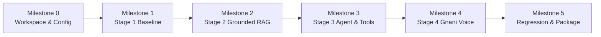

# VoiceOps 2026: Project Architecture & Execution Specification

> **Authoritative Specification Document**  
> Grounded in `VoiceOps_2026_Capstone_Brief.pdf` and verified dataset assets.

---

## 1. Executive Summary & Authoritative Rubric (100 Marks)

As specified on Page 13 of the VoiceOps Capstone Brief, submissions are scored out of 100 marks across 7 explicit criteria.

| Criterion | Stage | Marks | Grounded Evaluation Focus |
| :--- | :---: | :---: | :--- |
| **Correct, Grounded Answers** | Stage 2 | 25 | Answers strictly match knowledge-base documents; agent outputs explicit "I don't know / no information" when uncovered. |
| **Retrieval Quality** | Stage 2 | 15 | Correct `[SECTION-ID]` chunks identified; precision and recall against `gold_evidence`. |
| **Conversation Handling** | Stage 3 | 20 | Context memory, follow-ups, 1 clarifying question at a time, caller identity verification, policy refusals, and human escalations. |
| **Self-Evaluation & Comparison** | Stages 1 & 2 | 10 | Quantitative, empirical comparison between Stage 1 (prompting-only) and Stage 2 (grounded RAG) on `practice/questions.csv`. |
| **Voice Works End-to-End** | Stage 4 | 10 | Automated batch runner processes audio files via Gnani STT & TTS, emitting transcripts and synthesized audio. |
| **Voice Experience** | Stage 4 | 10 | Audio clarity, recovery from noisy ASR transcripts, conversational brevity, and spoken normalization (`[STY-3]`). |
| **Technical Report & Video Demo** | All | 10 | Max 4-page report (`report.pdf`) and max 2-minute demo video (`demo.mp4`). |
| **Total Marks** | | **100** | |

> [!CAUTION]
> **Disqualification Constraint:** Any use of an STT or TTS engine other than Gnani.ai (even as a secondary fallback) immediately disqualifies the submission.

---

## 2. Four-Stage Progressive Architecture

```mermaid
flowchart TD
    subgraph Stage1["Stage 1: Prompting-Only LLM Baseline"]
        P1["Direct System Prompt<br/>(AI Disclosure [STY-1])"] --> L1["LLM Zero-Shot Generation"]
        L1 --> E1["Benchmark on practice/questions.csv<br/>(Captures baseline error/hallucination rate)"]
    end

    subgraph Stage2["Stage 2: Document-Grounded RAG"]
        KB["21 kb/*.md documents"] --> Chunking["Metadata & [SECTION-ID] Chunking"]
        Chunking --> Index["Dense + BM25 Hybrid Index"]
        Index --> Retrieve["Precedence-Aware Retrieval<br/>(Policy > Guide > FAQ > Marketing)"]
        Retrieve --> L2["Grounded Generation<br/>(Strict Citations & IDK Fallback)"]
        L2 --> E2["Comparative Evaluation vs Stage 1"]
    end

    subgraph Stage3["Stage 3: Multi-turn Conversational Agent"]
        State["Session State & Memory"] --> DM["Dialog Manager"]
        DM --> IDV{"Identity Gate<br/>([IDV-1], [IDV-2])"}
        IDV -->|Unverified| AskProof["Ask Phone Last 4 / Pincode<br/>(Max 1 retry [IDV-3])"]
        IDV -->|Verified| Tools["tools.py (lookup_order)"]
        DM --> ESC{"Escalation Rule<br/>([ESC-1])"}
        ESC -->|Triggered| CRM["tools.py (create_ticket)"]
        DM --> E3["Benchmark on practice/conversations.csv<br/>(23 convs / 96 turns)"]
    end

    subgraph Stage4["Stage 4: Gnani.ai Voice Pipeline"]
        AudioIn["Customer Audio (.wav)"] --> GSTT["Gnani STT REST Client<br/>(en-IN code-mixed)"]
        GSTT --> TextIn["Transcribed ASR Text"]
        TextIn --> Stage3
        Stage3 --> TextOut["Agent Reply Text"]
        TextOut --> Norm["Spoken Text Normalizer<br/>([STY-3]: dates, currency, spaced digits)"]
        Norm --> GTTS["Gnani TTS Client<br/>(timbre-v2.5 / timbre-v3.0)"]
        GTTS --> AudioOut["Synthesized Reply (.wav)"]
    end
```



---

## 3. Strict Implementation Sequence

The project strictly follows the 6-milestone order:



* **Milestone 0 — Workspace, Setup & Testing Structure:**
  * Validate dataset integrity (`validate_dataset.py`).
  * Establish modular directory structure (`src/`, `tests/`, `docs/`, `results/`).
  * Implement configuration (`src/config.py`) locking reference date to `2026-10-20`.
  * Create unit tests for data schemas and tool security boundaries.
* **Milestone 1 — Stage 1 Prompting-Only Baseline:**
  * Build zero-shot prompted agent without document retrieval.
  * Evaluate all 52 questions in `practice/questions.csv`.
  * Persist raw evaluation outputs in `results/stage1_baseline.csv` (no fabricated scores).
* **Milestone 2 — Stage 2 Document-Grounded RAG:**
  * Parse and chunk 21 `kb/*.md` files, preserving `[SECTION-ID]`, status, and document type.
  * Implement hybrid search (BM25 + embeddings) with precedence ranking.
  * Evaluate same 52 questions; measure grounded accuracy, citation accuracy, and hallucination reduction vs Stage 1.
* **Milestone 3 — Stage 3 Multi-turn Agent, Identity Verification & Tools:**
  * Implement stateful dialog manager managing 1-retry verification budget.
  * Integrate `lookup_order` and `create_ticket` from `tools/tools.py`.
  * Validate across all 23 conversations (96 turns) in `practice/conversations.csv`.
* **Milestone 4 — Stage 4 Gnani.ai Voice Layer & Batch Audio Runner:**
  * Integrate `gnani-vachana` STT & TTS clients.
  * Implement spoken text normalizer adhering to `[STY-3]`.
  * Implement batch CLI runner: `python run.py --input_dir <dir> --output_dir <dir>`.
* **Milestone 5 — Regression Testing, Report, Demo & Final Packaging:**
  * Run full end-to-end regression test suite.
  * Generate 4-page technical report (`report.pdf`).
  * Record/generate 2-minute demonstration video (`demo.mp4`).
  * Assemble clean distributable archive `team_name_voiceops.zip`.

---

## 4. Batch Command Contract (`run.py`)

The official evaluation runs in unattended batch mode:
```bash
python run.py --input_dir /path/to/test_audio/ --output_dir /path/to/results/
```
The script outputs:
1. `results.jsonl`: Each line containing `audio_filename`, `transcript_heard`, `agent_reply_text`, `retrieved_section_ids`, `tools_called`, and `execution_status`.
2. Audio reply `.wav` files named `<input_basename>_reply.wav`.
